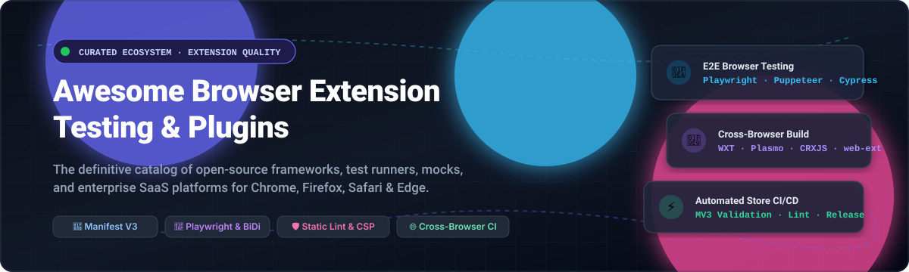

  

# 🧪 Awesome Browser Extension Testing & Plugins 

  
  
  
  
  
  

---

## 🧭 Executive Summary & SEO Overview

Welcome to the **Awesome Browser Extension Testing & Plugins** directory—a community-maintained compilation of high-performance tools, test automation frameworks, browser extension development kits, and cloud infrastructure platforms. 

Whether you are authoring extensions using **Manifest V3 (MV3)**, running **end-to-end (E2E) integration tests** in headless Chromium/Firefox/WebKit with **Playwright**, **Puppeteer**, **Cypress**, or **Selenium WebDriver BiDi**, or automating static compliance checking via **addons-linter**, this repository provides an authoritative guide to modern cross-browser quality assurance.

### 🔍 Key Capabilities & Search Highlights
- **Cross-Browser Test Automation**: Automated extension testing on Google Chrome, Mozilla Firefox, Microsoft Edge, Opera, and Apple Safari.
- **Manifest V3 Readiness**: Validations for declarative net request (`declarativeNetRequest`), offscreen documents, background service workers, and CSP restrictions.
- **Cloud Infrastructure & Device Clouds**: Scalable grid testing with pre-loaded extensions (`.crx`, `.xpi`, unpacked directories) across real OS devices and virtual machines.
- **Mocking & Unit Testing**: Complete stubbing of `chrome.*` and `browser.*` APIs in Jest, Vitest, and Mocha environments.

---

## 📑 Table of Contents
- [📊 Sector Overview & Market Dynamics](#-sector-overview--market-dynamics)
- [☁️ SaaS Products](#️-saas-products)
- [💻 Open-Source GitHub Projects](#-open-source-github-projects)
- [🤝 How to Contribute](#-how-to-contribute)
- [📜 Disclaimer](#-disclaimer)
- [📈 Star History](#-star-history)
- [💖 Support](#-support)

---

## 📊 Sector Overview & Market Dynamics

The global **automated testing software market** is estimated at **$24B–$40B** (projected to exceed **$80B+** by 2034 with a CAGR of ~14–17%), with the specialized **cross-browser testing sub-sector** representing roughly **$1.9B–$2.8B** (~10–12% CAGR).

The browser extension testing and cloud execution sector is **moderately concentrated at the infrastructure level**—where a handful of enterprise test cloud giants (Microsoft/Playwright, BrowserStack, Sauce Labs, and LambdaTest) capture the vast majority of distributed grid runtime demand—yet **highly fragmented at the tooling and developer framework layer**, where independent open-source toolkits (WXT, Plasmo, Extension.js, CRXJS, and community mocks) continuously emerge to bridge rapid browser engine changes, store review policy shifts, and Manifest V3 API migrations.

---

## ☁️ SaaS Products

The following hosted platforms provide dedicated cloud infrastructure, virtual machine grids, real desktop/mobile environments, and developer portal workflows for packaging, testing, and distributing browser extensions.

*Sorted descending by estimated company valuation / market capitalization.*

| Company / Product | Description | Valuation / Scale | Pricing | Free Tier / Trial Limit |
| :--- | :--- | :--- | :--- | :--- |
| **[Microsoft Edge Add-ons Hub](https://partner.microsoft.com/dashboard/microsoftedge/)** | Microsoft's enterprise partner center providing submission pipelines, store review verification, and automated certification scans for Edge extensions. | **$3.1+ Trillion** (Market Cap) | **Free** ($0 submission) | **Free Forever**: Unlimited extension submissions and developer dashboard access with a standard verified Microsoft Developer account. |
| **[Google Chrome Web Store Developer Console](https://chrome.google.com/webstore/devconsole)** | Google's primary distribution and developer console featuring automated security scanning, RSA key distribution, staged rollouts, and beta tester channels. | **$2.2+ Trillion** (Alphabet Market Cap) | **$5 one-time** registration fee | **Free Forever After Fee**: Unlimited extension uploads, staged rollouts, and beta tester distribution groups after the one-time $5 verification fee. |
| **[Apple Safari Web Extension Tools](https://developer.apple.com/documentation/safariservices/safari_web_extensions)** | Apple's official tooling suite including the Xcode extension converter, test harnesses, and App Store distribution pipelines for macOS and iOS Safari extensions. | **$3.4+ Trillion** (Market Cap) | **$99/year** (Apple Developer Program) | **Free Developer Tools**: Xcode and `safari-web-extension-converter` are free forever for local simulation; $99/year required only for App Store distribution and TestFlight. |
| **[BrowserStack Extension Tools](https://www.browserstack.com/)** | Cloud testing platform supporting pre-loaded Chrome/Edge extensions from Web Stores or local `.zip`/`.crx` builds (up to 100 MB) across real Windows and macOS browsers; includes Playwright/Selenium automation support. | **~$4.08 Billion** (Series B Valuation; ~$225M+ ARR) | Starts at **$29/month** (Live desktop manual) / **$59/month** (Automate parallel session) | **Free Trial Only**: 30 minutes of manual Live testing and 100 minutes of automated testing; Percy visual testing offers a free tier of 5,000 snapshots/month. |
| **[Sauce Labs](https://saucelabs.com/)** | Cloud-based automated and live testing grid providing cross-browser extension verification, Chrome/Firefox profile pre-loading, and headless execution. | **~$613 Million** (Valuation; ~$100M+ ARR) | Starts at **$39/month** (Live Testing) / **$149/month** (Virtual Device Cloud automation) | **Free Trial Only**: 28-day free trial with 60 testing minutes across up to 3 parallel virtual machines and 50 AI queries; free sponsorship available for open-source projects. |
| **[LambdaTest](https://www.lambdatest.com/)** | Continuous testing cloud supporting custom browser extension loading in Chrome, Edge, and Firefox with HyperExecute high-speed test orchestration. | **~$400 Million** (Series D Valuation; ~$50M+ ARR) | Starts at **$15/month** (Live Testing) / **$79/month** (Automation parallel test) | **Free Forever Tier**: 60 minutes/month of live real-time browser testing (10 mins per session) and 100 minutes/month of automated testing across standard environments. |
| **[Plasmo Itero](https://www.plasmo.com/)** | Continuous deployment, automated staging, and beta tester distribution hub designed specifically as a "TestFlight for browser extensions." | **Seed-stage / Indie** (Developer SaaS) | Starts at **$30/month** (Starter tier for up to 2 extensions) | **Free Forever Tier**: Core open-source Plasmo framework is 100% free (MIT); free cloud tier includes community Discord support and GitHub Actions store deployment runners. |

---

## 💻 Open-Source GitHub Projects

*Curated open-source testing frameworks, automation runners, build toolkits, and mock libraries. Sorted descending by GitHub stargazers count.*

- **[Playwright](https://github.com/microsoft/playwright)**   
  High-performance browser automation library supporting Chromium, Firefox, and WebKit; supports custom extension testing harnesses via `--disable-extensions-except` and `--load-extension` flags, service worker inspection, and background context fixtures.

- **[Puppeteer](https://github.com/puppeteer/puppeteer)**   
  Node.js library providing a high-level API over the Chrome DevTools Protocol (CDP); frequently used for headless/headful extension automation, background worker debugging, and popup interaction.

- **[Cypress](https://github.com/cypress-io/cypress)**   
  Next-generation front-end testing tool capable of loading unpacked Chrome extensions via browser launch arguments and validating page-injection behaviors.

- **[Selenium WebDriver](https://github.com/SeleniumHQ/selenium)**   
  Standard browser automation ecosystem supporting cross-browser extension pre-loading via `ChromeOptions.addExtensions` / `FirefoxProfile.addExtension` and WebDriver BiDi extension management.

- **[Plasmo](https://github.com/PlasmoHQ/plasmo)**   
  Modular framework for browser extensions with Parcel bundler, declarative `package.json` manifests, hot-reloading CSUI (Content Scripts UI), and cross-browser target building.

- **[WXT](https://github.com/wxt-dev/wxt)**   
  Next-generation Vite-powered extension framework featuring file-convention manifest generation, unified cross-browser APIs (Chrome, Edge, Firefox, Safari), TypeScript support, and blazing fast HMR.

- **[WebdriverIO](https://github.com/webdriverio/webdriverio)**   
  Next-gen browser automation framework for Node.js with native support for Chrome extensions (`--load-extension`), Firefox `.xpi` add-on installation, and WebDriver BiDi `installExtension()` / `uninstallExtension()` APIs.

- **[Extension.js](https://github.com/extension-js/extension.js)**   
  Zero-config cross-browser framework using `manifest.json` as the single source of truth; includes an internal Rspack bundler, targeted live-reload for popups/content scripts, and automated Safari conversion and build pipelines.

- **[CRXJS Vite Plugin](https://github.com/crxjs/chrome-extension-tools)**   
  Vite plugin for modern Chrome Extension development; parses `manifest.json` directly into the Vite build pipeline with full HMR for content scripts, popups, options pages, and background service workers.

- **[web-ext](https://github.com/mozilla/web-ext)**   
  Mozilla's official CLI to build, run, package, and lint WebExtensions; integrates directly into CI/CD workflows for AMO automated linting and Firefox testing.

- **[vite-plugin-web-extension (aklinker1)](https://github.com/aklinker1/vite-plugin-web-extension)**   
  Vite plugin that facilitates building cross-browser extensions (Manifest V2 and V3) with automatic multi-page setup, asset bundling, and browser launch commands.

- **[playwright-crx](https://github.com/ruifigueira/playwright-crx)**   
  Playwright port customized to execute and automate testing directly inside Chrome extensions and web extension contexts.

- **[DeploySentinel Recorder](https://github.com/DeploySentinel/Recorder)**   
  Browser extension that captures real user browser interactions and automatically generates Cypress, Playwright, and Puppeteer test scripts.

- **[addons-linter](https://github.com/mozilla/addons-linter)**   
  Mozilla's open-source suite for validating and linting add-ons against security, compatibility, and manifest structure rules before release.

- **[vite-plugin-web-extension (samrum)](https://github.com/samrum/vite-plugin-web-extension)**   
  A Vite plugin enabling streamlined bundling and live reloading for WebExtension manifest configurations across browsers.

- **[jest-webextension-mock](https://github.com/clarkbw/jest-webextension-mock)**   
  A Jest helper module providing complete mocks for the `browser` and `chrome` extension APIs for isolated unit testing.

- **[cypress-browser-extension-plugin](https://github.com/ejoubaud/cypress-browser-extension-plugin)**   
  Cypress plugin allowing end-to-end testing of browser extensions by streamlining extension bundle loading into Cypress browser instances.

- **[mockzilla-webextension](https://github.com/Lusito/mockzilla-webextension)**   
  TypeScript-first mocking toolkit for WebExtension APIs designed for Jest and Vitest unit test suites.

- **[chrome-extension-testing-mcp](https://github.com/BHUVAN-RJ/chrome-extension-testing-mcp)**   
  Model Context Protocol (MCP) server enabling AI coding agents to test unpacked Chrome extensions interactively via Playwright (service worker logs, popups, storage, badges).

- **[chrome-extension-test-framework](https://github.com/ibushimaru/chrome-extension-test-framework)**   
  Fast static analysis and verification framework (no browser needed) for validating Manifest V3 compliance, security, CSP restrictions, and file structure in CI.

---

## 🤝 How to Contribute

Contributions are warmly welcomed! To suggest a tool, framework, or platform:

1. **Fork** the repository.
2. Create a descriptive feature branch (`git checkout -b feat/add-awesome-tool`).
3. Add or update the entry in `README.md` following the established formatting guidelines.
4. Include:
   - Tool name & GitHub link / homepage link
   - Accurate, factual 1–2 sentence description
   - Star badge (for open source) or pricing & free tier parameters (for SaaS)
5. Submit a **Pull Request** detailing why the project belongs here.

---

## 📜 Disclaimer

- This is an **independently curated community list** and does not constitute an endorsement of any particular commercial platform or vendor.
- Cross-browser extension specifications and browser capabilities evolve frequently (e.g., MV2 deprecation timelines, `sidePanel` and declarative Net Request API differences). Always consult the official developer documentation of Google Chrome, Mozilla Firefox, Microsoft Edge, and Apple Safari.

---

## 📈 Star History

---

## 💖 Support

Thank you for visiting and supporting the **Awesome Browser Extension Testing & Plugins** ecosystem! 🌟

If you found this repository valuable, here is how you can help support its ongoing curation and growth:
- ⭐ **Star** this repository on GitHub to increase its visibility among developers.
- 🍴 **Fork** and contribute new tools, testing frameworks, or updated documentation.
- 📢 **Share** this collection with your fellow engineering teammates, QA teams, and extension developer communities on Twitter/X, LinkedIn, Reddit, or Discord.
- ☕ **Buy a coffee / Sponsor**: If you'd like to support ongoing open-source curation and development work, consider sponsoring via the [GitHub Sponsor Dashboard](https://github.com/sponsors/ishandutta2007). Your support is immensely appreciated! 🙏
